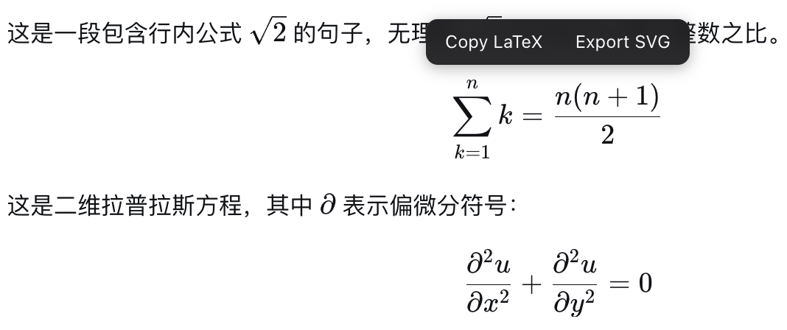
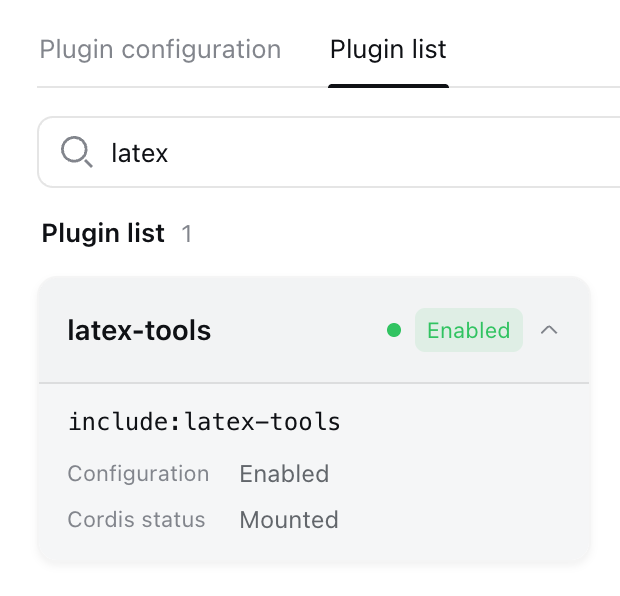

<h1 align="center">dsh-latex-tools</h1>

<p align="center">English | <a href="./README.md">中文</a></p>

<p align="center">♾️ Copy and export the LaTeX in DeepSeek Harness — hover any LaTeX formula to copy its TeX source or export it as a standalone SVG file</p>

<p align="center">🐳 All the code is proudly generated by DeepSeek V4 Flash 0731</p>

<p align="center">
  
</p>

## Features

- **Copy LaTeX**: hover over any formula (inline or block) and click "Copy LaTeX" — the TeX source goes straight to your clipboard.
- **Export SVG**: click "Export SVG" and the formula is rendered by MathJax into a **self-contained vector image** (glyph outlines embedded as paths, no external fonts or styles), downloaded as `formula-<slug>.svg` — ready for papers, slides, and web pages.
- **Fully offline**: the MathJax script is served by the plugin's own host half and fetched lazily on the first export, then cached by the browser — no CDN dependency.
- Supports inline and block formulas (block formulas are exported in display mode).

## Installation

Requirements: install Node.js, then run with the official npm command (no global install needed):

```sh
npx @deepseek-ai/dsh web
```

The plugin is loaded automatically once it is installed into the profile — **no manual enabling needed**; the Settings → Plugins list only shows plugins with configuration options, and this plugin has none, so it will not appear there.

One-command npm install:

```sh
npx @deepseek-ai/dsh plugin --profile web add dsh-latex-tools
```

This installs the prebuilt package — no local build, no extra configuration. Restart the Web UI and you are done.

### Verify the installation

```sh
npx @deepseek-ai/dsh --profile web --dump-config   # you should see the "# == dsh-latex-tools" layer
# Browser checks:
#   /plugins/dsh-latex-tools/client.js   —— the browser-half bundle
#   /dsh-latex-tools/mathjax/es5/tex-svg.js  —— the MathJax used for SVG export (~2.1 MB)
```

<p align="center">
  
</p>

### Uninstall

```sh
npx @deepseek-ai/dsh plugin --profile web remove dsh-latex-tools
```

Removes the plugin dependency and its config layer from the `web` profile. It takes effect after restarting the Web UI.

<details>
<summary><b>Development</b> (build, test, GitHub/source installs — click to expand)</summary>

```sh
pnpm install
pnpm typecheck   # tsc --noEmit
pnpm test        # vitest (jsdom: toolbar show/hide, copy, SVG export)
pnpm build       # tsdown: lib/index.js (host half) + lib/client.js (browser half)
```

### Install from GitHub (no local build)

```sh
npx @deepseek-ai/dsh plugin --profile web add github:liuup/dsh-latex-tools
```

Git installs fetch the source and pnpm runs the package's `prepare` script to build it. pnpm ≥10 refuses to run `prepare` for git dependencies by default, so the **first `add` will fail** — `dsh` prints the exact fix: add the printed entry to the profile's `pnpm-workspace.yaml` (under `allowBuilds`), then re-run the command. For production, pin a commit: `github:liuup/dsh-latex-tools#<commit-sha>`.

### Install from source (development / personal use)

```sh
git clone https://github.com/liuup/dsh-latex-tools.git
cd dsh-latex-tools
pnpm install && pnpm build          # builds lib/ (gitignored, so a local build is required)
npx @deepseek-ai/dsh plugin --profile web add link:/absolute/path/to/dsh-latex-tools
npx @deepseek-ai/dsh web            # start the Web UI
```

</details>

## License

[MIT](./LICENSE)
